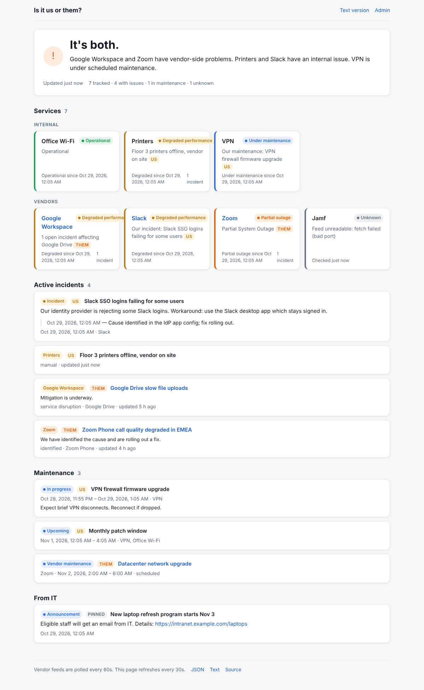

# Is It Us or Them?

**Your IT status page. One question. A clearer answer.**

[](https://github.com/WaylandP/is-it-us-or-them/actions/workflows/ci.yml)
[](LICENSE)
[](package.json)

**Is It Us or Them?** is a free, open-source, self-hosted status dashboard for IT teams. It brings external vendor outages, internal checks, scheduled maintenance, and IT announcements into one place, so employees can quickly understand what's happening without another "is everything down?" message.

- **Self-hosted:** your infrastructure, configuration, and data; no required cloud account or subscription.
- **Lightweight:** Express 5 and vanilla JavaScript; no frontend build or external database.
- **Designed for IT:** service ownership, incident timelines, maintenance windows, and a clear status summary.



> [!IMPORTANT]
> This is an early-stage project (package version `0.1.0`). Review [Security](SECURITY.md) before exposing it outside a trusted network. Upgrading an existing installation? Read the [monitoring migration notes](docs/MONITORING_SECURITY.md#upgrade-checklist): private checks require explicit approval, service configuration reads require authentication, and outbound HTTP proxies are not supported by the hardened transport.

## The answer at a glance

| Verdict | Meaning |
| --- | --- |
| **It's Us** | An internal system or IT-managed incident/maintenance is affected. |
| **It's Them** | Current external-provider evidence reports a problem. |
| **It's Both** | Internal and external issues coexist, including on the same service. |
| **All Clear** | All enabled monitored services have current operational reports. |
| **Status Uncertain** | Current health cannot be established for one or more services. |
| **Maintenance Reported** | A service reports maintenance without an incident classified as internal or external. |

An unreadable, blocked, failed, or stale check is **not** proof of health or a verified outage. Last-known status is retained as historical context. A current internal incident remains visible even when its vendor feed is unavailable.

## What works today

- **Service dashboard** with groups, ownership, service cards, light/dark themes and mobile layouts.
- **Six check types:** Atlassian Statuspage, Slack, Google Workspace/Cloud, RSS/Atom, HTTP and manual.
- **Incident posts** with severity, affected services, resolution, pinned messages and timeline updates.
- **Maintenance scheduling** with upcoming and active windows; upcoming windows appear up to 14 days ahead.
- **Admin interface** for adding, editing, testing, disabling, refreshing and removing services.
- **Plain-text status** at `/api/status.txt` and an optional verified Slack slash command.
- **Freshness enforcement** across JSON, text, Slack and the public dashboard. Cached/offline data stays visibly unverified.
- **Guarded monitoring requests** with destination validation, DNS pinning, redirect checks and response limits.
- **Docker and Compose** deployment, local JSON persistence and automated tests.

## Quick start: Docker Compose

**Requirements:** Docker Engine with the Compose plugin, direct outbound access for vendor checks, and a free host port.

```bash
git clone https://github.com/WaylandP/is-it-us-or-them.git
cd is-it-us-or-them
cp .env.example .env
openssl rand -hex 32
```

Paste the generated value into `.env` as `ADMIN_TOKEN=...`, then:

```bash
docker compose up -d --build
docker compose ps
```

Open **http://localhost:3000** for status or **http://localhost:3000/admin** for administration. Compose binds **only to 127.0.0.1** by default. Use a reverse proxy, VPN or deliberate bind address for remote access; see [Deployment](docs/DEPLOYMENT.md).

A fresh installation seeds Google Workspace, Slack, Zoom and Jamf. These need outbound internet access and can be removed. Internal checks require `CHECK_ALLOWED_TARGETS`; blocked checks remain unknown rather than being reported as outages.

### Run directly with Node.js

Requires Node.js 20.10+ and npm. Supply a unique token through your environment or process manager:

```bash
npm ci
export ADMIN_TOKEN="$(openssl rand -hex 32)"
npm start
```

Keep the token available for admin login; do not share it in logs or screenshots. Data defaults to `./data/data.json`. `npm run dev` restarts on file changes. Unlike Compose, `npm start` does not automatically load `.env`.

## Configure your status page

Open `/admin`, enter the configured token, then add a service, use **Test feed**, and save. Choose **Vendor** for external services or **Internal** for systems your team manages.

| Provider | Intended use |
| --- | --- |
| `statuspage` | Statuspage-compatible vendors; base URL and optional component filters |
| `slack` | Slack's public status API; no credentials required |
| `google` | Google Workspace/Cloud incident feeds; optional product filters |
| `rss` | Recent feed items are interpreted by a **heuristic**, not verified active-incident detection |
| `http` | Observed HTTP status and latency; DNS/TLS/timeouts or policy failures leave health unknown |
| `manual` | IT-declared state, not an independent probe of the underlying service |

Use **Maintenance** for planned work and **Announcements** for messages or incidents with updates. Native Microsoft 365 and Teams integrations are not implemented; see [Roadmap](docs/ROADMAP.md) for planned work, not promises.

## Configuration

Compose reads `.env`; direct Node deployments use environment variables.

| Variable | Default | Purpose |
| --- | --- | --- |
| `ADMIN_TOKEN` | Generated and logged if unset outside Compose | Admin writes and service configuration reads; Compose requires a value |
| `PORT` | `3000` | Server listening port |
| `DATA_DIR` | `./data` (Node) / `/data` (Docker) | JSON persistence |
| `SITE_NAME` / `ORG_NAME` | `Is it us or them?` / `IT` | Branding and announcement attribution |
| `POLL_INTERVAL_SECONDS` | `60` | Check interval |
| `FETCH_TIMEOUT_MS` | `10000` | Total request deadline, including DNS, redirects and body |
| `STATUS_STALE_AFTER_SECONDS` | Derived; `180` with default settings | Observation expiry threshold |
| `CHECK_ALLOWED_TARGETS` | `{}` | Exact-origin to CIDR map for private/nonstandard-port checks |
| `SEED_SERVICES` | `true` | Seed services on initial setup only |
| `SLACK_SIGNING_SECRET` | unset | Optional Slack request verification |

Compose-only `BIND_ADDRESS` and `HOST_PORT` control the host port. Never commit a real `.env`. Example private-target policy and compatibility details are in [Monitoring security](docs/MONITORING_SECURITY.md).

## API and automation

- `GET /api/status`: public dashboard snapshot, without service configuration blocks.
- `GET /api/status.txt[?q=zoom]`: public text report with the same freshness rules.
- `GET /api/providers`, `/api/maintenance`, `/api/posts`: public reads.
- `GET /api/services`: **admin authentication required**, including HEAD requests.
- `GET /healthz`: process health, **not** proof of monitored-service health.
- `POST /api/services`, `PUT /api/services/:id`, `PATCH /api/services/:id/state`, `DELETE /api/services/:id`: admin writes; analogous maintenance/post endpoints exist.
- `POST /api/services/test`, `POST /api/services/:id/refresh`: admin checks using the same network policy as scheduled polling.
- `POST /slack/command`: optional Slack command response; configure its signing secret.

Admin calls require `Authorization: Bearer <ADMIN_TOKEN>`. Public status, posts and maintenance still contain operational information; protect access when that information is private.

```bash
curl http://localhost:3000/api/status.txt
curl -H "Authorization: Bearer $ADMIN_TOKEN" http://localhost:3000/api/services
```

## Architecture and development

```text
public/                 Static dashboard/admin interface
src/providers/           Provider adapters
src/check-network.js     Bounded, destination-validated check transport
src/freshness.js         Observation age and expiry
src/poller.js            Checks, timestamps and configuration generations
src/verdict.js           Ownership and aggregate state
src/snapshot.js          JSON snapshot and text report
src/routes/              API endpoints
src/store.js             Local JSON persistence
test/                    node:test suites and sanitized fixtures
```

```bash
npm ci
npm test
npm run dev
```

Read [Architecture](docs/ARCHITECTURE.md), [Deployment](docs/DEPLOYMENT.md), [research and threat model](docs/MONITORING_SECURITY.md), [Contributing](CONTRIBUTING.md), and [Security](SECURITY.md).

## Known limitations

- **Single process and persistent filesystem:** not a serverless or multi-replica service.
- Poll results live in memory; no historical uptime database. Restart triggers fresh polling.
- Freshness means the monitoring observation is recent, not that a vendor's underlying data is complete. Manual declarations and RSS heuristics retain their limitations.
- Private target approval grants access to any path on that exact origin within the approved CIDRs. Keep approvals narrow and restrict network egress. DNS pinning cannot identify a malicious forwarding service behind an otherwise allowed address.
- HTTP/HTTPS/ALL proxy environment variables are rejected. Proxy-dependent deployments need a reviewed networking solution before upgrading.
- The admin bearer token is still stored in browser local storage. Use a trusted browser, HTTPS and VPN/SSO protection.
- No built-in multiuser roles, SSO, alert delivery, or Teams integration. This hardening is not a penetration-test certification.

## Contribute

Read [CONTRIBUTING.md](CONTRIBUTING.md) for provider and test guidance. For vulnerabilities, follow [SECURITY.md](SECURITY.md), **not** a public bug report.

## Contributors and AI assistance

Created and maintained by [Wayland Pearce (@WaylandP)](https://github.com/WaylandP), with contributions recorded in the repository's Git history.

**ChatGPT (OpenAI)** has contributed AI-assisted research, implementation, regression tests, security hardening, monitoring-freshness improvements, and documentation under the maintainer's direction. Earlier contributor credits remain preserved in Git history.

AI assistance is acknowledged transparently; project decisions, review, and releases remain the responsibility of the human maintainers. This acknowledgment does not imply sponsorship or endorsement by OpenAI.

Licensed under the [MIT License](LICENSE). No subscription and no mandatory telemetry.
