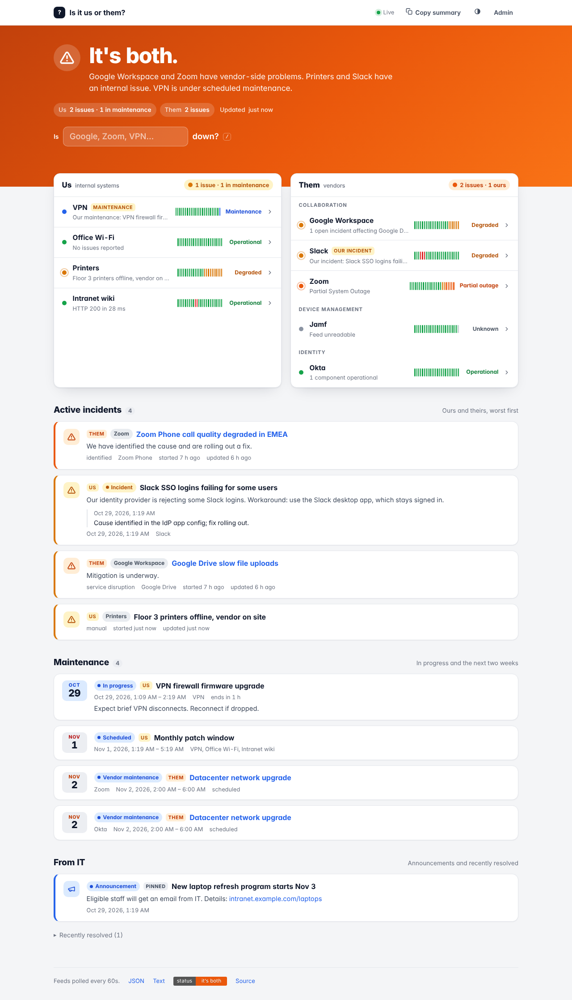
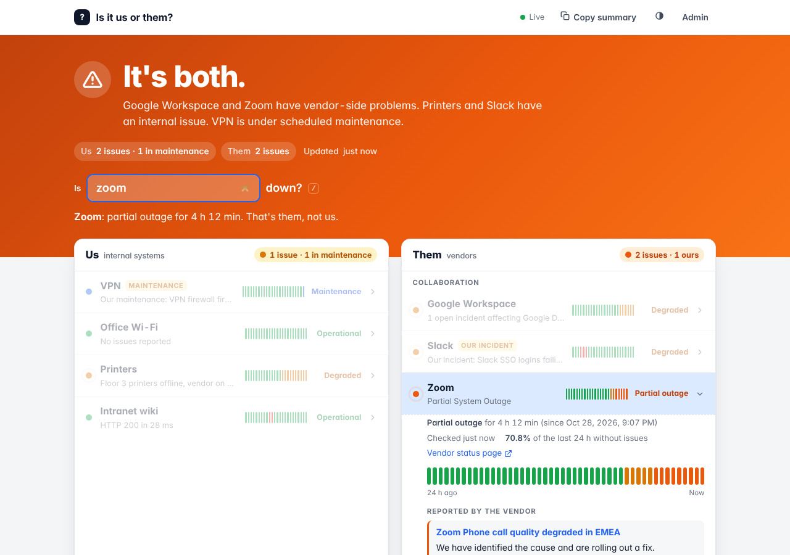
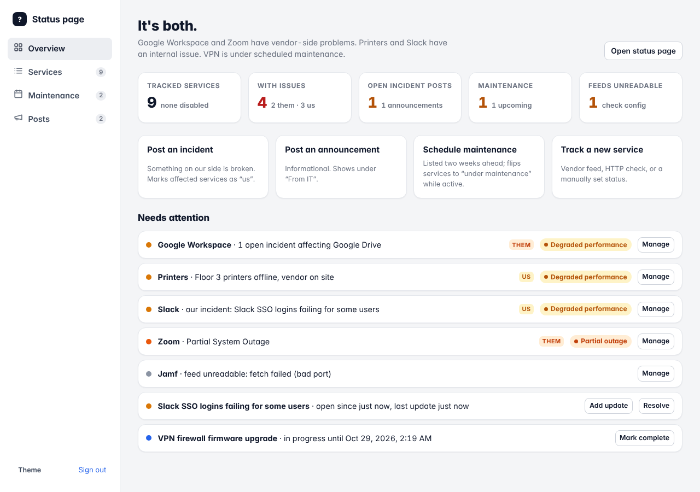

# Is it us or them?

[](https://github.com/WaylandP/is-it-us-or-them/actions/workflows/ci.yml)
[](LICENSE)
[](package.json)

An internal IT status page that answers the question before anyone asks it.

It combines **vendor status feeds** (Google Workspace, Slack, Zoom, Jamf, and
anything on Statuspage.io or with an RSS feed) with **your own maintenance
calendar** and **IT announcements**, then puts a one-line verdict at the top:

> **It's them.** Zoom is having problems on the vendor side.
>
> **It's us.** VPN is under scheduled maintenance.
>
> **All clear.** All 7 tracked services look operational.

When someone pings "is Google down?", the answer is already posted. It also
gives your IT team's comms a home: incidents with timeline updates, pinned
announcements, and scheduled maintenance windows, all on one page.

Zero build step, one runtime dependency (Express), data in a single JSON file.



## Features

- **Verdict banner**: "It's us." / "It's them." / "It's both." / "All clear.",
  computed from vendor feeds plus your own maintenance and incident posts.
  The whole header changes colour with the overall state.
- **Us | Them columns**: internal systems on the left, vendors on the right,
  each with its own tally. A vendor service that is broken because of
  something *you* did is flagged "our incident" and counted as "us".
- **"Is ___ down?"**: type a name into the header to get a one-line answer
  ("Zoom: partial outage for 2 h 10 min. That's them, not us."). Press `/`
  to focus it; the query is kept in the URL so links can be shared.
- **24-hour history bars** per service, with an expandable detail panel:
  how long the current state has lasted, availability over the last day,
  vendor incidents and scheduled maintenance, and a link to the vendor page.
- **Track whatever you want**: add, edit, test, reorder (drag or arrow keys),
  disable and remove services from the admin page. Six feed providers cover
  most vendors and internal systems (see below).
- **Maintenance calendar**: scheduled windows show up two weeks ahead and
  automatically flip affected services to "under maintenance" while active.
- **IT comms**: announcements, incident posts with timeline updates, pinning,
  and resolution. An open incident post on a service marks it as "us", even
  if the vendor says everything is fine.
- **Live**: open pages update within a second of a poll or an admin change
  (server-sent events, with polling as a fallback).
- **Chat-friendly**: a "Copy summary" button and `GET /api/status.txt` give a
  plain-text brief for pasting into Slack or Teams; a Slack slash command
  endpoint is built in; `/badge.svg` is an embeddable status badge for wikis.
- **Light and dark** (automatic or forced), phone-friendly, accessible.
- **Admin overview** with counts, quick actions and a "needs attention" list;
  **admin API** with a bearer token, so you can script it.

<p align="center">
  
  
</p>

## Quick start

```bash
git clone https://github.com/WaylandP/is-it-us-or-them.git
cd is-it-us-or-them
npm install
ADMIN_TOKEN=change-me npm start
```

Open <http://localhost:3000>. The admin page is at `/admin`; paste the
`ADMIN_TOKEN` to sign in. A fresh install comes seeded with Google Workspace,
Slack, Zoom, and Jamf. Remove or edit them freely.

If you do not set `ADMIN_TOKEN`, a random one is generated and printed in the
server log at startup.

### Docker

```bash
cp .env.example .env     # set ADMIN_TOKEN at minimum
docker compose up -d
```

Data is kept in the `status-data` volume at `/data/data.json`. That one file
holds the services, maintenance windows, posts and 90 days of state-change
history (used for the history bars). Back it up like any other config file.

## Adding and removing services

Go to `/admin` → **Services** → **Add service**. Pick a feed provider, fill in
its fields, hit **Test feed** to see what it returns, then save. Every row has
refresh, edit and delete controls, an on/off switch, and an owner toggle.
Drag the handle (or focus it and use the arrow keys) to reorder. Disabled
services are kept but not polled or shown.

Each service has an **owner**:

- **Vendor**: problems reported by the feed count as *them*.
- **Internal**: problems count as *us*.

And a **group** heading for the public page (for example "Vendors",
"Internal", "Collaboration").

### Feed providers

| Provider | Use it for | Configuration |
| --- | --- | --- |
| `statuspage` | Any Atlassian Statuspage site: Zoom, Jamf, GitHub, Atlassian, Cloudflare, Dropbox, Okta, Twilio, DigitalOcean, ... | Status page root URL (reads `/api/v2/summary.json`). Optional list of component names to narrow it down, e.g. `Zoom Meetings, Zoom Phone`. |
| `slack` | Slack | Nothing. Reads `slack-status.com/api/v2.0.0/current`. |
| `google` | Google Workspace or Google Cloud | Feed URL (defaults to the Workspace dashboard) and an optional product list, e.g. `Gmail, Google Meet, Google Drive`. |
| `rss` | Vendors that only publish an RSS/Atom status feed | Feed URL and a window in hours. Items newer than the window are shown as active incidents and mark the service degraded. Heuristic, but better than nothing. |
| `http` | Internal apps, VPN portal, wiki, anything with a URL | URL to request. 2xx/3xx is operational. Optional exact status code and a latency threshold for "degraded". |
| `manual` | Printers, Wi-Fi, phones, badge readers: things nothing monitors for you | The IT team sets the state and a message from the admin page or via `PATCH /api/services/:id/state`. |

Microsoft 365 is not included because its service health API requires a Graph
app registration. Point an `rss` provider at a third-party feed, or use a
`manual` service, in the meantime.

### Corporate proxies

Vendor feeds are fetched with Node's built-in `fetch`. If the host needs an
egress proxy, set `HTTPS_PROXY` (and `NO_PROXY`) and run with
`NODE_USE_ENV_PROXY=1` (Node 22.21+ / 24). The Docker image sets that flag
already.

## Configuration

All configuration is through environment variables. See `.env.example`.

| Variable | Default | Meaning |
| --- | --- | --- |
| `PORT` | `3000` | Listen port |
| `ADMIN_TOKEN` | generated | Token for the admin page and write API |
| `DATA_DIR` | `./data` | Directory holding `data.json` |
| `POLL_INTERVAL_SECONDS` | `60` | How often vendor feeds are polled |
| `FETCH_TIMEOUT_MS` | `10000` | Per-feed request timeout |
| `SITE_NAME` | `Is it us or them?` | Page title / brand |
| `ORG_NAME` | `IT` | Used in "From IT" |
| `SLACK_SIGNING_SECRET` | empty | If set, Slack slash command requests are verified |
| `SEED_SERVICES` | `true` | Seed Google/Slack/Zoom/Jamf on first run |

## Slack slash command

1. Create a Slack app with a slash command, e.g. `/isitdown`, pointing at
   `https://status.example.com/slack/command`.
2. Put the app's signing secret in `SLACK_SIGNING_SECRET`.
3. `/isitdown` posts the full brief; `/isitdown zoom` filters to matching
   services.

The server must be reachable from Slack for this to work. Without it,
`/api/status.txt` gives the same text for copy-and-paste.

## API

Reads are public. Writes need `Authorization: Bearer <ADMIN_TOKEN>`.

```
GET    /api/status                 everything the page shows, as JSON
GET    /api/status.txt[?q=zoom]    plain-text brief
GET    /api/stream                 server-sent events: a fresh snapshot on every change
GET    /badge.svg[?label=IT]       embeddable SVG status badge
GET    /api/providers              provider descriptors (drives the admin form)
GET    /healthz

GET    /api/services
POST   /api/services               { name, provider, owner, group, statusPageUrl, description, order, enabled, config }
POST   /api/services/test          same body; checks the feed without saving
PUT    /api/services/order        { ids: [...] } in display order
PUT    /api/services/:id           partial update
PATCH  /api/services/:id/state     { state, message }  (manual services only)
POST   /api/services/:id/refresh   poll now
DELETE /api/services/:id

GET    /api/maintenance
POST   /api/maintenance            { title, description, services: [id], startsAt, endsAt, status }
PUT    /api/maintenance/:id
DELETE /api/maintenance/:id

GET    /api/posts
POST   /api/posts                  { title, body, severity: info|warning|critical, services: [id], pinned, resolved }
PUT    /api/posts/:id
POST   /api/posts/:id/updates      { body, resolved? }  append a timeline update
DELETE /api/posts/:id

POST   /slack/command              Slack slash command (form-encoded)
```

Example: set a manual service to degraded from a script.

```bash
curl -X PATCH http://localhost:3000/api/services/<id>/state \
  -H "Authorization: Bearer $ADMIN_TOKEN" -H "Content-Type: application/json" \
  -d '{"state":"degraded","message":"Floor 3 printers offline, vendor on site"}'
```

### Service states

`operational`, `maintenance`, `degraded`, `partial_outage`, `major_outage`,
`unknown` (feed could not be read; the last known state is kept alongside).

## How the verdict is decided

For each enabled service:

1. If an **unresolved incident post** (warning/critical) names it, the service
   shows that severity and counts as **us**.
2. Else if an **active maintenance window** names it, the service shows
   "under maintenance" and counts as **us**.
3. Else the feed's state is used. A problem counts as **them** for
   vendor-owned services and **us** for internal ones.

Incident posts and maintenance windows with no services attached still count
as "us". The headline is "both" when there is at least one of each.

## Development

```bash
npm run dev     # restarts on file changes
npm test        # node:test, no network needed (feeds are mocked)
```

Layout:

```
src/
  server.js        entry point
  app.js           Express app factory (used by tests)
  poller.js        polls providers on an interval, keeps statuses in memory
  verdict.js       us-or-them logic
  snapshot.js      builds /api/status and the text brief
  timeline.js      turns state-change history into 24h history bars
  badge.js         the SVG status badge
  store.js         JSON file persistence, including state-change history
  providers/       one file per feed type; add your own here
  routes/          public, services, maintenance, posts, slack
public/            static UI (no build step)
test/              node:test suites and recorded feed fixtures
```

### Adding a provider

Create `src/providers/<name>.js` exporting `{ id, label, description,
defaultOwner, fields, check(service, ctx) }` and register it in
`src/providers/index.js`. `fields` drives the admin form; `check` returns
`{ state, summary, incidents, maintenances }`. See `statuspage.js` for a
complete example.

## Deployment notes

This is a long-running Node process with a file on disk, so run it on a VM,
a container host, or a small Kubernetes deployment with a persistent volume.
It is not suited to serverless platforms. Put it behind your SSO proxy or
VPN if the page itself should be internal-only; the admin token only
protects writes.

## Contributing and security

See [CONTRIBUTING.md](CONTRIBUTING.md) for the development workflow and the
provider contract, and [SECURITY.md](SECURITY.md) for deployment guidance and
how to report a vulnerability. Changes are tracked in
[CHANGELOG.md](CHANGELOG.md).

## License

[MIT](LICENSE)
